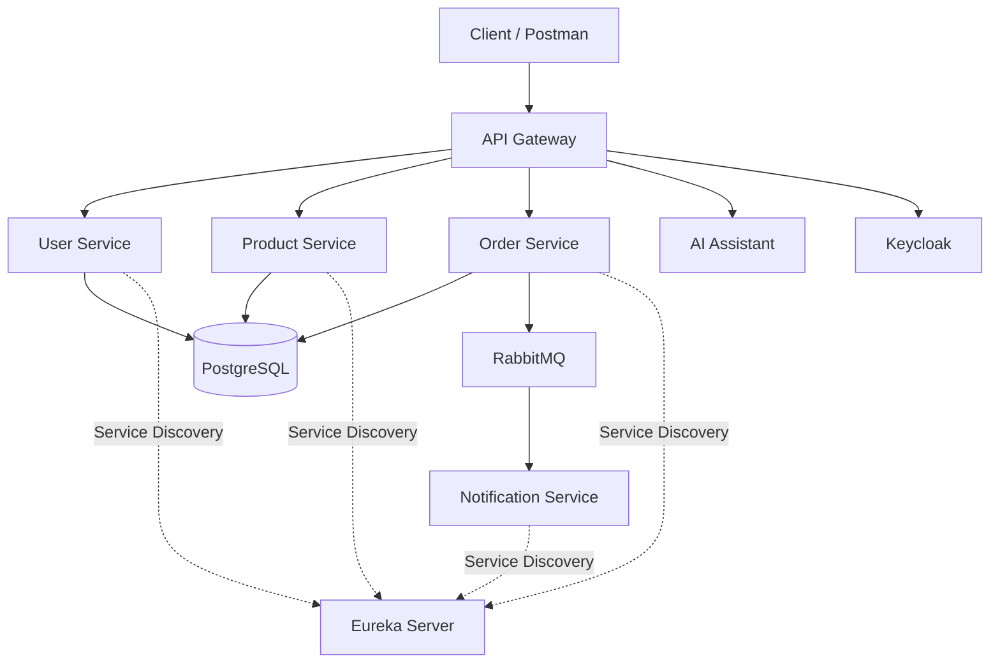

# E-Commerce Microservices Platform

A Dockerized e-commerce backend built with **Spring Boot microservices**, featuring service discovery, API Gateway, authentication and authorization with Keycloak, asynchronous messaging with RabbitMQ, distributed order processing, and an AI-powered shopping assistant.

## Architecture



## Microservices

| Service | Responsibility |
|---|---|
| API Gateway | Central entry point, request routing, and security |
| Eureka Server | Service discovery and registration |
| User Service | User management, validation, and Keycloak integration |
| Product Service | Product CRUD, search, stock management, and stock reservation |
| Order Service | Cart, order placement, payment workflow, and saga handling |
| Notification Service | Consumes order events through RabbitMQ |
| AI Assistant | AI-powered chat and product recommendations |

## Technology Stack

- **Backend:** Java 17, Spring Boot
- **Microservices:** Spring Cloud Gateway, Eureka
- **Security:** Spring Security, Keycloak, OAuth 2.0, OpenID Connect, JWT
- **Database:** PostgreSQL, Spring Data JPA, Hibernate
- **Messaging:** RabbitMQ
- **Resilience:** Resilience4j, Circuit Breaker, Retry, TimeLimiter
- **Distributed Transactions:** Saga Pattern, Compensation, Saga Recovery
- **AI Integration:** GROQ API
- **Containerization:** Docker, Docker Compose
- **Build Tool:** Maven
- **CI/CD:** GitHub Actions

## Key Features

### Authentication and Authorization
- Keycloak-based authentication
- JWT validation
- Role-based access control
- Secure API Gateway and service endpoints
- Service-to-service communication

### Product Management
- Create, read, update, and delete products
- Product search
- Stock validation and reservation
- Concurrent stock reservation handling

### Order Management
- Shopping cart functionality
- Order placement and validation
- Payment workflow
- Saga-based order processing
- Compensation mechanisms for failed workflows
- Saga recovery

### Reliability and Resilience
- Circuit Breaker using Resilience4j
- Retry mechanism
- TimeLimiter for timeout handling
- Idempotent order requests
- Protection against duplicate order creation

### Asynchronous Notifications
- Publish order events through RabbitMQ
- Notification service consumes order events asynchronously

### AI Assistant
- AI-powered shopping assistant using GROQ API
- Product recommendation functionality

## Project Structure

```text
E-COMMERCE-PROJECT/
├── ai-assistant/
├── api-gateway/
├── eureka/
├── notification/
├── Order/
├── Product/
├── user/
├── docker/
│   └── postgres/
│       └── init.sql
├── .github/
│   └── workflows/
│       └── microservices-ci.yml
├── compose.yaml
├── Dockerfile.ai
└── .gitignore
```

## Getting Started

### Prerequisites

- Docker Desktop
- Git
- Java 17 (for running services locally)
- Maven Wrapper (included in the project)
- Keycloak configuration
- GROQ API key for the AI Assistant

### 1. Clone the Repository

```bash
git clone https://github.com/Abhivirani/E-COMMERCE-PROJECT.git
cd E-COMMERCE-PROJECT
```

### 2. Configure Environment Variables

Create a local `.env` file in the project root.

Configure the required environment variables for PostgreSQL, RabbitMQ, Keycloak, and the AI Assistant according to `compose.yaml` and each service's `application.properties`.

**Do not commit `.env` or expose credentials, API keys, or client secrets.**

### 3. Start the Application

```bash
docker compose up -d --build
```

### 4. Verify Running Containers

```bash
docker compose ps
```

### 5. View Logs

```bash
docker compose logs -f
```

To view logs for a particular service:

```bash
docker compose logs -f api-gateway
docker compose logs -f Order
docker compose logs -f notification
```

### 6. Stop the Application

```bash
docker compose down
```

To remove containers and volumes as well:

```bash
docker compose down -v
```

> Warning: `docker compose down -v` deletes persistent database volumes.

## Service Ports

| Service | Port |
|---|---:|
| API Gateway | 8080 |
| Eureka Server | 8761 |
| Product Service | 8081 |
| User Service | 8082 |
| Order Service | 8083 |
| Notification Service | 8084 |
| AI Assistant | 8085 |
| PostgreSQL | 5432 |
| RabbitMQ | 5672 |
| RabbitMQ Management UI | 15672 |
| Keycloak | 9090 |

Ports depend on the local configuration.

## Testing

Each microservice uses the Maven Wrapper.

Example:

```powershell
cd Order
.\mvnw.cmd clean verify
```

Run the same command from each service directory to compile and execute its tests.

## Continuous Integration

GitHub Actions workflow:

`.github/workflows/microservices-ci.yml`

The CI workflow builds and tests the microservices using Java 17 and Maven Wrapper.

It runs on:
- Push events
- Pull requests
- Manual workflow dispatch

The workflow uses a matrix strategy to build the services independently.

## Repository

GitHub: https://github.com/Abhivirani/E-COMMERCE-PROJECT

## Future Improvements

- Improve observability with centralized logging and distributed tracing
- Add API documentation using OpenAPI / Swagger
- Add monitoring using Prometheus and Grafana
- Improve payment integration
- Expand integration and end-to-end testing
- Implement deployment automation

## Author

**Abhivirani**

GitHub: https://github.com/Abhivirani
